# Satellite Orbital Decay & Atmospheric Re-entry Prediction

Predicts remaining on-orbit lifetime (`days_to_decay`) and terminal atmospheric re-entry timelines for Earth-orbiting satellites from historical Two-Line Element (TLE) observations.

- **Headline Result:** **2.44 days MAE (15.9% relative error)** on `< 30-day` terminal re-entry prediction, down from **38.55 days MAE (250.1% relative error)** on the baseline `HistGradientBoosting` model.
- **Dataset Scale:** **832,434 curated TLE observations** across **195 decayed LEO satellites** spanning **57 years** of Space-Track & CelesTrak history (1969–2026).
- **Evaluation Rigor:** Strict **80/20 satellite-level split** (156 train / 39 held-out test satellites) — zero temporal or entity leakage across partitions.
- **Key Modeling Insight:** Combining a `log1p(y)` target transform with an explicit elapsed-time lifecycle feature (`days_since_first_epoch`) eliminates both the terminal re-entry plateau and long-horizon MSE bias.

---

### Pipeline Evolution at a Glance

| Pipeline Stage | Rows | Satellites | Columns | Primary Artifact | Description |
| --- | ---: | ---: | ---: | --- | --- |
| **1. Raw Consolidation** | 950,677 | 204 | 41 | [`tle_features.parquet`](data/preprocessed/tle_features.parquet) | Ingestion of 204 Space-Track JSON files + CelesTrak decay catalog join |
| **2. Deduplicated Archive** | 832,452 | 204 | 41 | [`tle_features_modeling.parquet`](data/curated/tle_features_modeling.parquet) | Removed 118,225 redundant duplicate epoch records via verified `GP_ID` chronology |
| **3. Filtered Modeling Input** | 832,434 | 195 | 41 | [`tle_features_modeling.parquet`](data/curated/tle_features_modeling.parquet) | Excluded 9 sub-10-record debris fragments unable to support rolling feature computation |
| **4. Feature-Engineered Dataset** | 832,434 | 195 | 42 | [`features.parquet`](data/modeling/features.parquet) | Dynamic decay rates, multi-span rolling orbital statistics, lifetime index, and target label |
| **5. Entity-Split Partitions** | 691,441 / 140,798 | 156 / 39 | 30 | [`train_satellites.csv`](data/splits/train_satellites.csv) / [`test_satellites.csv`](data/splits/test_satellites.csv) | Strict 80/20 satellite-level split (zero satellite leakage between train and test) |
| **6. Final Model (Variant D)** | 140,798 (Test) | 39 (Test) | 35 | [`hgb_variant_d_combined.joblib`](models/hgb_variant_d_combined.joblib) | **231.32d Overall MAE**, **2.44d Terminal MAE (<30d)** via log-target & temporal progression |

---

## Table of Contents

1. [Data Sources & Ingestion](#data-sources--ingestion)
2. [Repository Structure](#repository-structure)
3. [Core Engineering Decisions & Methodology](#core-engineering-decisions--methodology)
4. [Exploratory Data Analysis & Empirical Findings](#exploratory-data-analysis--empirical-findings)
5. [Feature Engineering & Target Formulation](#feature-engineering--target-formulation)
6. [Satellite-Level Data Partitioning (Zero-Leakage Split)](#satellite-level-data-partitioning-zero-leakage-split)
7. [Baseline Model Benchmarks](#baseline-model-benchmarks)
8. [Diagnostic Findings: Bucketed Error Analysis & The Horizon Paradox](#diagnostic-findings-bucketed-error-analysis--the-horizon-paradox)
9. [Astrodynamic Outlier Audit (NORAD 37518)](#astrodynamic-outlier-audit-norad-37518)
10. [Model Evolution & Systematic Improvements](#model-evolution--systematic-improvements)
11. [Final Model Inference & Insights](#final-model-inference--insights)
12. [Pipeline Execution Guide](#pipeline-execution-guide)
13. [Project Status & Roadmap](#project-status--roadmap)

---

## Data Sources & Ingestion

The pipeline aggregates data across two astronomical and space surveillance providers:

### 1. Space-Track.org API (18th Space Defense Squadron)

Historical General Perturbations (GP) orbital element sets provided in OMM (Orbit Mean-Elements Message) JSON format:

- **Identifiers:** `NORAD_CAT_ID`, `OBJECT_ID`, `OBJECT_NAME`
- **Timestamps:** `EPOCH` (observation epoch), `CREATION_DATE` (record generation timestamp)
- **Keplerian Elements:** `MEAN_MOTION` (n), `ECCENTRICITY` (e), `INCLINATION` (i), `RA_OF_ASC_NODE` (Ω), `ARG_OF_PERICENTER` (ω), `MEAN_ANOMALY` (M)
- **Perturbations & Native Derived Parameters:** `BSTAR` (drag term B*), `MEAN_MOTION_DOT` (ṅ/2), `MEAN_MOTION_DDOT` (n̈/6), `SEMIMAJOR_AXIS` (a), `PERIOD` (T), `APOAPSIS` (rₐ), `PERIAPSIS` (rₚ)
- **Catalog Metadata:** `GP_ID`, `FILE`, `TLE_LINE0`, `TLE_LINE1`, `TLE_LINE2`, `OBJECT_TYPE`, `RCS_SIZE`, `COUNTRY_CODE`, `SITE`, `DECAY_DATE`

### 2. CelesTrak Satellite Catalog

Historical satellite decay registry:

- Joined via `NORAD Catalog Number` → `NORAD_CAT_ID`.
- Exports `CATALOG_DECAY_DATE`: 100% complete across all processed satellites.

---

## Repository Structure

```text
satelite/
│
├── data/
│   ├── raw/
│   │   ├── tle_history/                          # 204 raw Space-Track JSON historical files (read-only)
│   │   └── decayed_satellites.csv                # CelesTrak ground-truth decay catalogue (read-only)
│   │
│   ├── preprocessed/
│   │   └── tle_features.parquet / .csv           # Raw consolidated archive (950,677 rows, 204 sats)
│   │
│   ├── curated/
│   │   └── tle_features_modeling.parquet / .csv  # Deduped & filtered dataset (832,434 rows, 195 sats)
│   │
│   ├── splits/
│   │   ├── train_satellites.csv                  # 156 locked training satellite NORAD IDs
│   │   └── test_satellites.csv                   # 39 locked held-out test satellite NORAD IDs
│   │
│   ├── plots/                                    # Exported predicted-vs-actual scatter plots
│   │
│   └── modeling/
│       ├── features.parquet / .csv               # Final feature matrix (832,434 rows, 42 cols)
│       ├── train_features.parquet                # Partitioned training matrix (691,441 rows)
│       └── test_features.parquet                 # Partitioned test matrix (140,798 rows)
│
├── models/
│   ├── linear_regression.joblib                  # Baseline Linear Regression model (floor)
│   ├── random_forest.joblib                      # Baseline Random Forest Regressor (max_depth=20)
│   ├── hist_gradient_boosting.joblib             # Baseline Histogram Gradient Boosting Regressor
│   ├── hgb_variant_a_days_elapsed.joblib         # Variant A: Temporal Progression model
│   ├── hgb_variant_b_short_window.joblib         # Variant B: Short-window Rolling model
│   ├── hgb_variant_c_log_target.joblib           # Variant C: Log-Target Transformed model
│   └── hgb_variant_d_combined.joblib             # Final Model: Combined A + B + C model
│
├── src/
│   ├── data_collection/
│   │   ├── fetch_spaceTrack.py                   # Automated Space-Track API data collection
│   │   ├── fetch_celesTrack.py                   # CelesTrak decay catalog downloader
│   │   └── verify_tle_jsons.py                   # JSON syntax and schema integrity verifier
│   │
│   ├── data_processing/
│   │   ├── 01_TLE_json_to_parquet.py             # Raw JSON ingestion, string decoding, CelesTrak join
│   │   ├── 02_database_validation.py             # Checksum, range, and completeness validation
│   │   ├── 03_data_profiling.py                  # Statistical profiling and initial distribution plots
│   │   ├── 04_temporal_analysis.py               # Annual observation counts and satellite active spans
│   │   ├── 05_satellite_history_analysis.py      # Individual satellite trajectory case studies
│   │   ├── 06_outlier_analysis.py                # IQR-based outlier flagging across orbital elements
│   │   ├── 07_outlier_investigation.py           # Deep physical dive into extreme orbital regimes
│   │   ├── 08_duplicate_record_investigation.py  # Audit of identical (NORAD, EPOCH) observation pairs
│   │   ├── 09_repeated_epoch_analysis.py         # GP_ID vs CREATION_DATE chronological proof
│   │   ├── 10_apply_deduplication.py             # Chronological deduplication script
│   │   └── 11_apply_tle_count_filter.py          # Exclusion of sparse sub-10-TLE debris fragments
│   │
│   ├── modeling/
│   │   ├── 01_build_features.py                  # Label formulation, dynamic rates, and rolling stats
│   │   ├── 02_feature_validation.py              # Physics validation, null audit, target correlations
│   │   └── 03_train_test_split.py                # Satellite-level 80/20 partitioner & skew auditor
│   │
│   └── training/
│       ├── data_loader.py                        # Shared data loader & strict zero-overlap verification
│       ├── trainers/                             # Dedicated baseline training scripts
│       │   ├── 01_train_linear_regression.py
│       │   ├── 02_train_random_forest.py
│       │   ├── 03_train_hist_gradient_boosting.py
│       │   └── train_baseline_models.py          # Unified runner for all 3 baselines
│       └── evaluation/                           # Diagnostic and improvement scripts
│           ├── 01_bucketed_error_analysis.py     # Horizon-specific error breakdown (<30d, 30-180d, etc.)
│           ├── 02_outlier_inspection.py          # Investigation of 5,000d vs 12,000d residual cluster
│           └── 03_evaluate_improvements.py       # Benchmarking of Variants A, B, C, & D
│
├── reports/
│   ├── eda/                                      # Exploratory analysis CSVs, distributions & outliers
│   └── modeling/
│       ├── baseline_model_comparison.csv         # Baseline performance summary
│       ├── bucketed_error_analysis.csv           # Detailed decay horizon breakdown
│       ├── outliers_5000_pred_12000.csv          # Full audit rows for NORAD 37518
│       ├── model_improvements_comparison.csv     # Summary of Variants A, B, C, D
│       ├── model_improvements_bucket_detail.csv  # Horizon-by-horizon comparison of all variants
│       └── *.png                                 # Predicted-vs-actual scatter plots
│
└── README.md
```

---

## Core Engineering Decisions & Methodology

### 1. Raw Data Immutability

All files in `data/raw/` are strictly read-only. Transformations output to isolated dataset tiers (`data/preprocessed/` and `data/modeling/`) to guarantee data lineage and repeatability.

### 2. Decay Date Provenance Separation

- **`DECAY_DATE` (Space-Track native):** Populated in only 201 out of 950,677 observations (99.98% missing).
- **`CATALOG_DECAY_DATE` (CelesTrak matched):** Populated across 100% of observations.
- Both fields are preserved independently to prevent silent overwriting of official USSPACECOM records while providing a verified ground truth for modeling.

### 3. Chronological Deduplication via GP_ID Agreement

Exploration in `08_duplicate_record_investigation.py` identified 118,225 records sharing identical `(NORAD_CAT_ID, EPOCH)` keys. Analysis in `09_repeated_epoch_analysis.py` showed:

1. Orbital parameter variations across duplicate records at identical epochs were negligible (`Δa < 10⁻⁴ km`).
2. Space-Track internal sequential identifier (`GP_ID`) and publication timestamp (`CREATION_DATE`) agreed on chronological order in **99.98% of comparable record pairs**.
3. **Deduplication Rule:** Within each `(NORAD_CAT_ID, EPOCH)` group, retain the record with the maximum numeric `GP_ID`, breaking ties with the latest `CREATION_DATE`.

```text
Deduplication Outcome:
  Rows before dedup:  950,677
  Rows after dedup:   832,452
  Redundant removed:  118,225 (12.44%)
  Unique epochs lost:       0
```

### 4. Exclusion of Sparse Debris Fragments

In `11_apply_tle_count_filter.py`, satellites with fewer than 10 total historical TLEs were audited. Nine satellites (NORAD IDs: `100822`, `101037`, `101038`, `101040`, `101041`, `101042`, `101047`, `101070`, `101384`) had only 1 to 8 records across their tracking life:

- These sparse fragments cannot support windowed rolling operations or numerical time differencing.
- Removing these 18 observations dropped the satellite count from 204 to **195 well-tracked satellites** (832,434 rows, each with ≥ 15 TLE observations; median 3,834).

### 5. Adoption of Native Space-Track Geometries

Earlier scripts re-calculated semi-major axis, apoapsis, and periapsis using numerical equations:

```text
a   = (μ / n²)^(1/3)
r_p = a(1 - e) - R_E
r_a = a(1 + e) - R_E
```

The pipeline now directly consumes Space-Track's native `SEMIMAJOR_AXIS`, `APOAPSIS`, `PERIAPSIS`, and `PERIOD` derived during SGP4 ephemeris generation, eliminating floating-point rounding divergence and standardizing unit definitions.

### 6. Target Formulation & Latency Noise Clipping

The prediction target is remaining orbital lifetime in fractional solar days:

```text
days_to_decay = (t_CATALOG_DECAY_DATE - t_EPOCH) / 86,400 seconds
```

Because TLEs are published with operational latency, terminal observations frequently carry epochs recorded within hours after the official catalog decay date, producing small negative values:

- Observations with `days_to_decay` in `[-1.0, 0.0)` are clipped to `0.0`, representing active decay at terminal observation.
- Large negative outliers (`< -1.0 day`) are isolated and reported for manual audit.

### 7. Boundary Effect NaN Handling (Drop vs. Impute)

At the initial observation (`t₀`) of each satellite, numerical differencing (`Δparam / Δt`) is physically undefined because no antecedent TLE exists. This produces exactly **195 boundary NaNs** (1 per satellite × 195 satellites = 195 rows, or 0.023% of the dataset):

- **Decision:** Dropped rather than imputed.
- **Rationale:** Imputing with `0.0` falsely implies zero decay velocity or acceleration at `t₀`, while backward-filling introduces lookahead signal. Dropping 195 rows leaves **832,239 complete rows** without synthetic noise.

### 8. Strict Satellite-Level Partitioning (Zero-Leakage Requirement)

> [!IMPORTANT]
> Because orbital elements are highly autocorrelated over time, randomly splitting records by row leaks identical satellite states across train and test partitions. All modeling splits **are performed strictly on unique `NORAD_CAT_ID` values**, testing whether models can predict re-entry for a completely unseen satellite.

---

## Exploratory Data Analysis & Empirical Findings

### Temporal Distribution & Annual Tracking Density

The dataset spans 57 years of spaceflight history (October 1969 to November 2026). While early decades average fewer than 5 active satellites per year, observation frequency increases substantially post-2015 due to high-cadence automated tracking of megaconstellation and smallsat re-entries.

| Annual Observations | Active Satellites per Year |
| :---: | :---: |
| [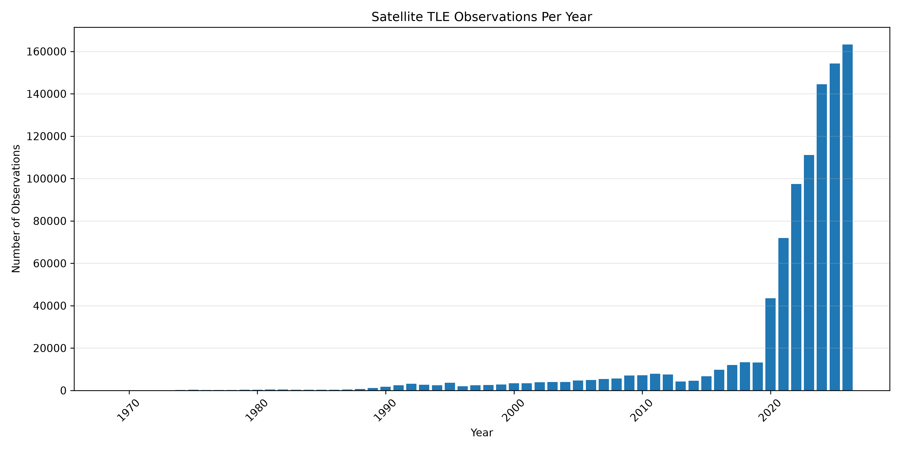](reports/eda/temporal/plots/observations_per_year.png) | [](reports/eda/temporal/plots/satellites_per_year.png) |
| *[View Full Size: observations_per_year.png](reports/eda/temporal/plots/observations_per_year.png)* | *[View Full Size: satellites_per_year.png](reports/eda/temporal/plots/satellites_per_year.png)* |

---

### Orbital Decay Trajectories (Case Studies)

Orbital decay exhibits distinct physical phases: prolonged quasi-linear altitude loss followed by rapid non-linear circularization and terminal plunge.

<details open>
<summary><b>Case Study: NORAD 4133 (Long-Duration High-Cadence Decay)</b></summary>
<br>

| Altitude Collapse (Periapsis vs. Time) | Drag Acceleration (Mean Motion vs. Time) | Ballistic Drag Coefficient (B* vs. Time) |
| :---: | :---: | :---: |
| [](reports/eda/satellite_history/NORAD_4133/periapsis_vs_time.png) | [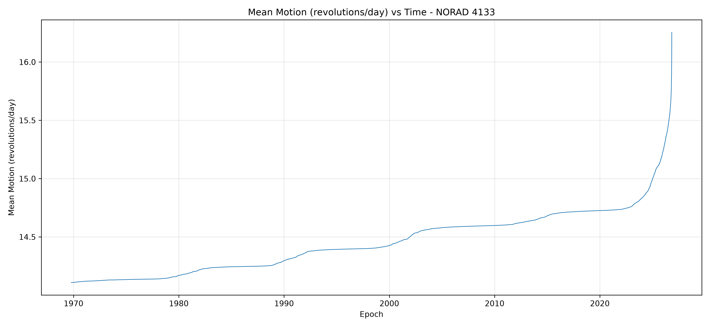](reports/eda/satellite_history/NORAD_4133/mean_motion_vs_time.png) | [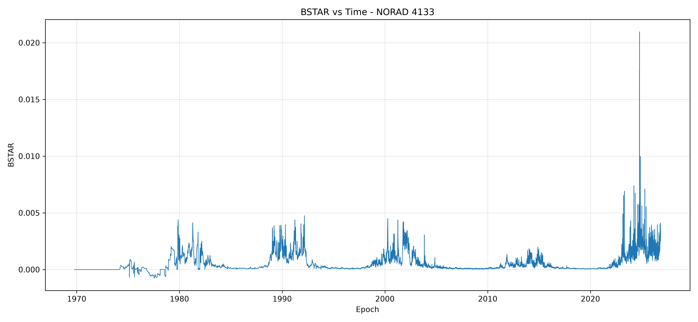](reports/eda/satellite_history/NORAD_4133/bstar_vs_time.png) |
| *[View: periapsis_vs_time.png](reports/eda/satellite_history/NORAD_4133/periapsis_vs_time.png)* | *[View: mean_motion_vs_time.png](reports/eda/satellite_history/NORAD_4133/mean_motion_vs_time.png)* | *[View: bstar_vs_time.png](reports/eda/satellite_history/NORAD_4133/bstar_vs_time.png)* |

</details>

<details>
<summary><b>Case Study: NORAD 7003</b></summary>
<br>

| Altitude Collapse (Periapsis vs. Time) | Drag Acceleration (Mean Motion vs. Time) | Ballistic Drag Coefficient (B* vs. Time) |
| :---: | :---: | :---: |
| [](reports/eda/satellite_history/NORAD_7003/periapsis_vs_time.png) | [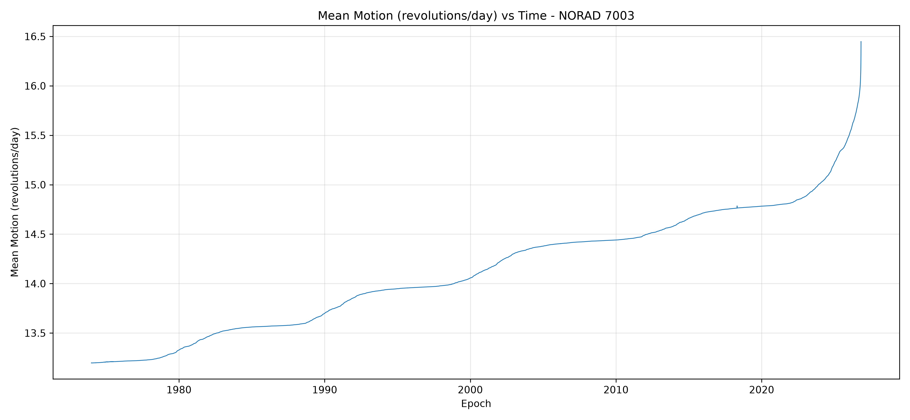](reports/eda/satellite_history/NORAD_7003/mean_motion_vs_time.png) | [](reports/eda/satellite_history/NORAD_7003/bstar_vs_time.png) |
| *[View: periapsis_vs_time.png](reports/eda/satellite_history/NORAD_7003/periapsis_vs_time.png)* | *[View: mean_motion_vs_time.png](reports/eda/satellite_history/NORAD_7003/mean_motion_vs_time.png)* | *[View: bstar_vs_time.png](reports/eda/satellite_history/NORAD_7003/bstar_vs_time.png)* |

</details>

---

### Global Parameter Distributions & Correlations

Orbital elements show expected clustering: Low Earth Orbit satellites exhibit near-circular geometries (`e ≈ 0`) with orbital periods concentrated between 88 and 100 minutes.

| Global Linear Correlation Matrix | Observation Epoch Distribution |
| :---: | :---: |
| [](reports/eda/plots/correlation_matrix.png) | [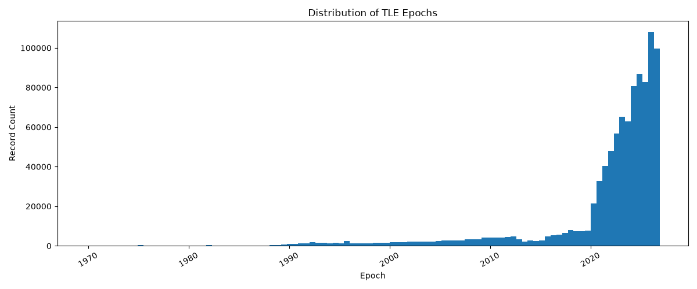](reports/eda/plots/epoch_distribution.png) |
| *[View: correlation_matrix.png](reports/eda/plots/correlation_matrix.png)* | *[View: epoch_distribution.png](reports/eda/plots/epoch_distribution.png)* |

| Semi-Major Axis (a) | Periapsis Altitude (rₚ) | Ballistic Drag Term (B*) |
| :---: | :---: | :---: |
| [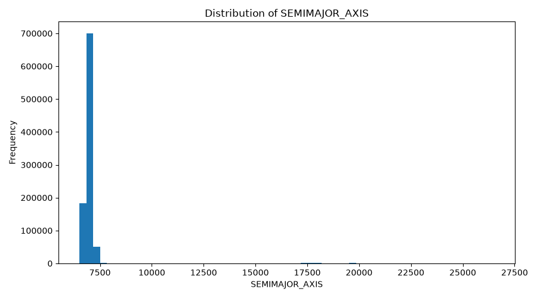](reports/eda/plots/SEMIMAJOR_AXIS_distribution.png) | [](reports/eda/plots/PERIAPSIS_distribution.png) | [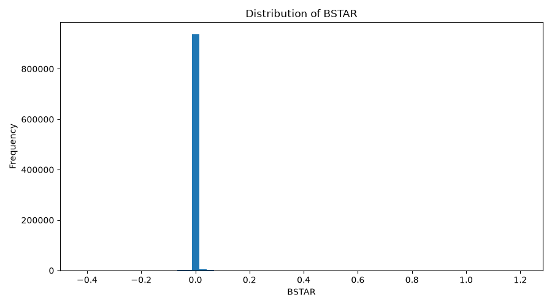](reports/eda/plots/BSTAR_distribution.png) |

---

### Outlier Regimes & High-Eccentricity Orbits

Statistical outlier analysis (`06_outlier_analysis.py` and `07_outlier_investigation.py`) confirmed that extreme values in the archive reflect genuine astrodynamics rather than data corruption:

- **High-Eccentricity Satellites (`e > 0.5`):** Highly elliptical transfer orbits and Molniya-type orbits with apogees exceeding 30,000 km and periapses deep in LEO.
- **Atmospheric Interface Trajectories:** Observations with perigee altitudes below 130 km correspond to the final orbits immediately preceding re-entry.

| Periapsis Outliers | Mean Motion Outliers |
| :---: | :---: |
| [](reports/eda/outliers/plots/periapsis_outliers.png) | [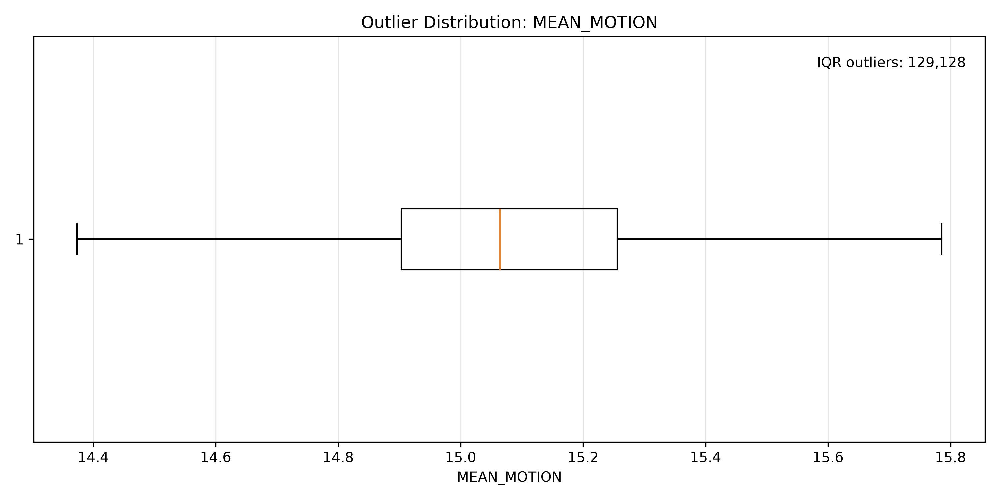](reports/eda/outliers/plots/mean_motion_outliers.png) |

---

## Feature Engineering & Target Formulation

The final dataset generated by `src/modeling/01_build_features.py` and validated by `src/modeling/02_feature_validation.py` resides at [`data/modeling/features.parquet`](data/modeling/features.parquet) (832,434 rows, 42 columns).

### Feature Rankings Against Target

Features ranked by absolute monotonic Spearman correlation (`|r_s|`) with `days_to_decay` from [`feature_correlations_target.csv`](reports/modeling/feature_correlations_target.csv):

| Feature Name | Spearman (r_s) | Pearson (r) | Type | Astrodynamic Interpretation |
| --- | ---: | ---: | --- | --- |
| `mean_motion_roll20` | **-0.7504** | -0.3260 | Derived (Rolling) | Smoothed orbital velocity; strongest decay predictor |
| `mean_motion_roll10` | **-0.7504** | -0.3265 | Derived (Rolling) | Medium-window mean motion |
| `mean_motion_roll5` | **-0.7495** | -0.3268 | Derived (Rolling) | Short-window mean motion |
| `MEAN_MOTION` | **-0.7479** | -0.3270 | Native Element | Instantaneous revolutions per day |
| `SEMIMAJOR_AXIS` | **+0.7479** | +0.2022 | Native Orbital | Orbital energy; higher orbits retain longer lifetimes |
| `PERIOD` | **+0.7478** | +0.1888 | Native Orbital | Orbital period in minutes |
| `APOAPSIS` | **+0.7447** | +0.1851 | Native Orbital | Apogee altitude |
| `lifetime_fraction` | **-0.6943** | -0.4796 | Derived (Progress) | Observation position along satellite's timeline |
| `MEAN_MOTION_DOT` | **-0.5709** | -0.0678 | Native Element | Drag acceleration (`ṅ/2`) |
| `PERIAPSIS` | **+0.5025** | +0.3982 | Native Orbital | Perigee altitude |
| `periapsis_roll20` | **+0.4973** | +0.3969 | Derived (Rolling) | Smoothed perigee altitude |
| `mean_motion_rate` | **-0.4919** | -0.0035 | Derived (Rate) | Empirical drag acceleration derivative (`Δn / Δt`) |
| `periapsis_rate` | **+0.3214** | +0.0051 | Derived (Rate) | Empirical altitude loss velocity (`Δrₚ / Δt`) |
| `bstar_roll20` | **-0.2981** | -0.0384 | Derived (Rolling) | Smoothed ballistic drag coefficient |
| `INCLINATION` | **-0.2741** | -0.1983 | Native Element | Orbital inclination relative to equatorial plane |

---

## Satellite-Level Data Partitioning (Zero-Leakage Split)

Executed by `src/modeling/03_train_test_split.py` with `RANDOM_SEED = 42`:

- **Unique Satellites:** 195 total → **156 Train Satellites (80.0%)** and **39 Test Satellites (20.0%)**.
- **Observation Rows:** **691,441 Train Observations (83.1%)** and **140,798 Test Observations (16.9%)**.
- **Partition Lockfiles:** Stored deterministically in [`train_satellites.csv`](data/splits/train_satellites.csv) and [`test_satellites.csv`](data/splits/test_satellites.csv).

### Balance & Skew Diagnostics

| Metric | Train Split (156 sats) | Test Split (39 sats) | Variance / Ratio | Sanity Assessment |
| --- | ---: | ---: | ---: | --- |
| **TLE Count per Satellite (Mean)** | 4,432.3 | 3,610.2 | 18.5% diff | Representative sample across lifetimes |
| **TLE Count per Satellite (Median)** | 4,147.5 | 3,091.0 | 1,056 diff | Balanced mix of short and long tracking arcs |
| **Mean Periapsis Altitude** | 520.47 km | 522.06 km | **0.3% diff** | Matching orbital altitude distribution |
| **Mean Semi-Major Axis** | 7,101.40 km | 7,094.85 km | **0.1% diff** | Matching orbital energy distribution |
| **Target Mean (`days_to_decay`)** | 1,326.65 days | 1,332.90 days | **0.5% diff** | Zero target shift between partitions |

---

## Baseline Model Benchmarks

Three models were trained strictly on the 156 training satellites and evaluated exclusively on the 39 held-out test satellites (140,798 rows) using all 30 standard features.

| Model Architecture | Implementation Details | Overall MAE (d) | Overall RMSE (d) | Wall-Clock Time | Model Artifact |
| --- | --- | ---: | ---: | ---: | --- |
| **Linear Regression (Floor)** | Standard OLS (`scikit-learn`) | 1,287.07 d | 1,557.96 d | **0.55 s** | [`linear_regression.joblib`](models/linear_regression.joblib) |
| **Random Forest Regressor** | `n_estimators=100`, `max_depth=20`, `n_jobs=-1` | 327.78 d | 858.69 d | 204.59 s | [`random_forest.joblib`](models/random_forest.joblib) |
| **HistGradientBoosting** | LightGBM-style binned boosting (`scikit-learn`) | **316.89 d** | **771.29 d** | **2.97 s** | [`hist_gradient_boosting.joblib`](models/hist_gradient_boosting.joblib) |

### Baseline Predicted vs. Actual Visualizations

| HistGradientBoosting (Baseline Best) | Random Forest Regressor | Linear Regression (Floor) |
| :---: | :---: | :---: |
| [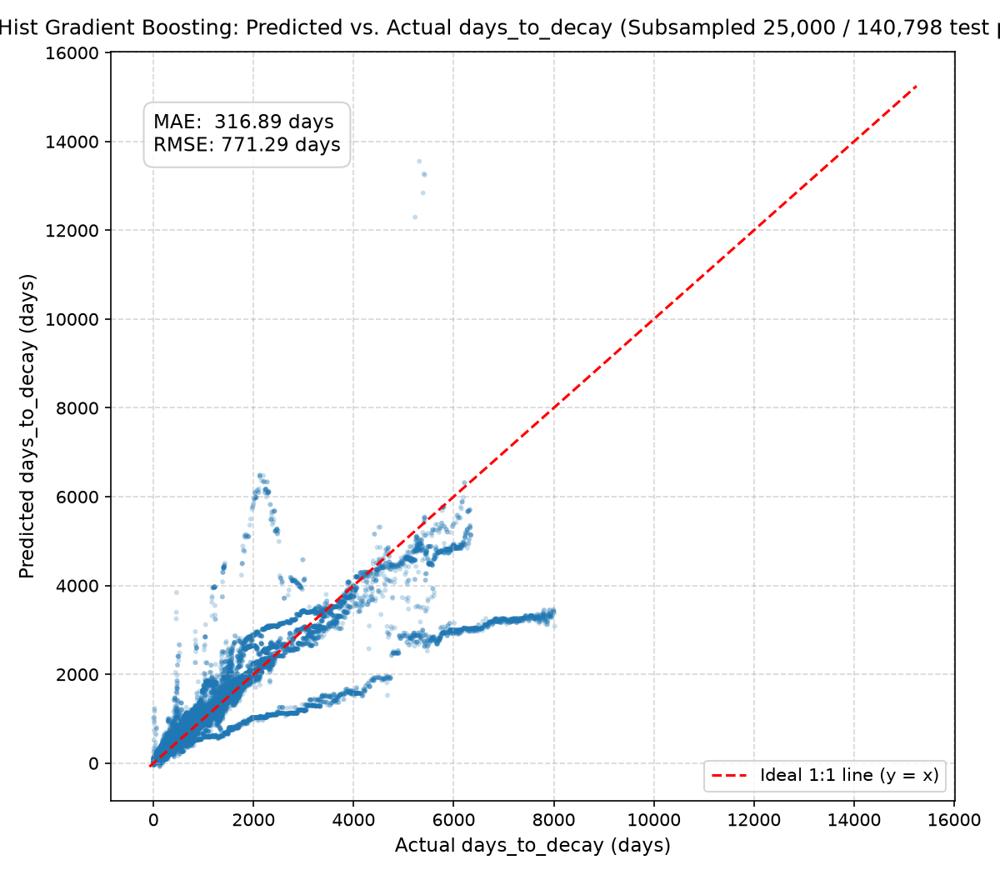](reports/modeling/predicted_vs_actual_hist_gradient_boosting.png) | [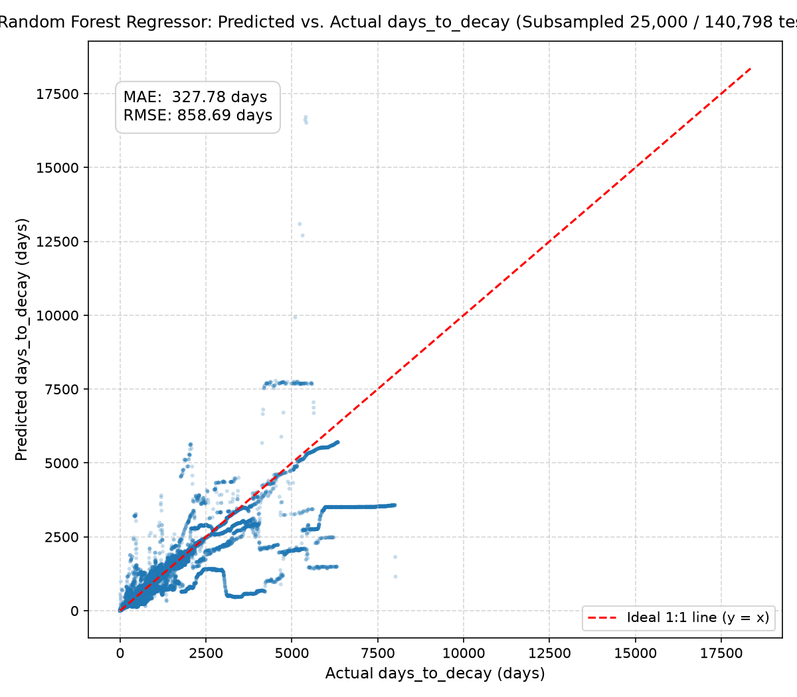](reports/modeling/predicted_vs_actual_random_forest.png) | [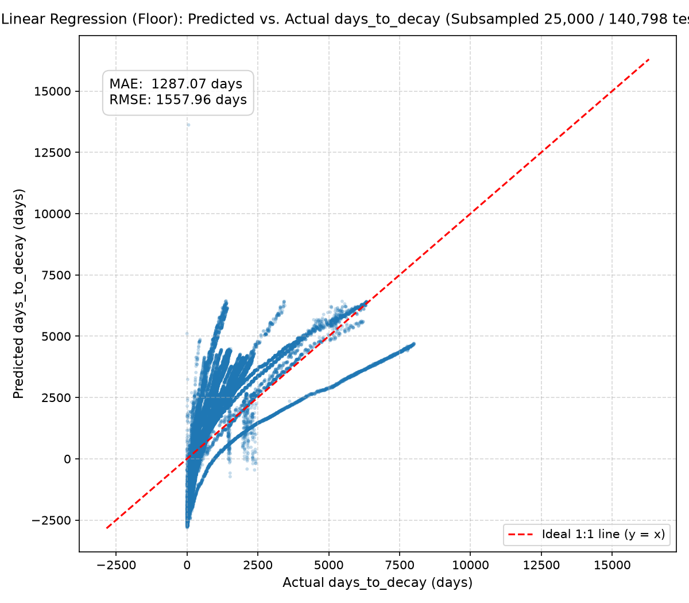](reports/modeling/predicted_vs_actual_linear_regression.png) |
| *[View Full Size: HGB](reports/modeling/predicted_vs_actual_hist_gradient_boosting.png)* | *[View Full Size: RF](reports/modeling/predicted_vs_actual_random_forest.png)* | *[View Full Size: LR](reports/modeling/predicted_vs_actual_linear_regression.png)* |

---

## Diagnostic Findings: Bucketed Error Analysis & The Horizon Paradox

While an overall MAE of ~316 days looked promising in aggregate, evaluating errors across **true decay horizons** (`src/training/evaluation/01_bucketed_error_analysis.py`) exposed a failure in the baseline models:

| Decay Horizon | Test Rows | Share (%) | Mean Actual (d) | Baseline HGB MAE | Baseline HGB Rel. Error | Baseline RF MAE | Baseline RF Rel. Error |
| --- | ---: | ---: | ---: | ---: | ---: | ---: | ---: |
| **`< 30 days` (Terminal Re-entry)** | 3,274 | 2.3% | 15.41 d | **38.55 d** | **250.1%** | **11.23 d** | **72.9%** |
| **`30 – 180 days` (Short-term)** | 14,302 | 10.2% | 105.53 d | **54.21 d** | **51.4%** | **21.67 d** | **20.5%** |
| **`180 – 365 days` (Medium-term)** | 17,369 | 12.3% | 267.49 d | **79.09 d** | **29.6%** | **61.64 d** | **23.0%** |
| **`> 365 days` (Long-term Bulk)** | 105,853 | 75.2% | 1,723.79 d | **400.01 d** | **23.2%** | **422.60 d** | **24.5%** |

### The Horizon Paradox Explained

1. **The Plateau Phenomenon:** Predictions for terminal-stage satellites flattened out at low non-zero values while true re-entry was imminent, causing an average error of **38.55 days on an object with only 15 days left**.
2. **Loss Function Asymmetry:** Because **75.2% of test rows belong to the `>365d` bucket**, raw mean squared error (MSE) optimization prioritized reducing a 400-day error in a 5-year trajectory over reducing a 20-day error in a 10-day trajectory.
3. **Missing Temporal Clock:** The models possessed instantaneous orbital coordinates, but lacked an explicit measure of where the object stood along its individual operational life cycle.

---

## Astrodynamic Outlier Audit (NORAD 37518)

In the baseline scatter plots, a distinct outlier cluster emerged where actual `days_to_decay` was **~5,000 to 5,500 days (~15 years)** but the model predicted **~10,000 to 14,000+ days (~30+ years)**.

Audited via `src/training/evaluation/02_outlier_inspection.py` and exported to [`outliers_5000_pred_12000.csv`](reports/modeling/outliers_5000_pred_12000.csv):

- **Object Identified:** All 16 anomalous observations belonged to satellite **NORAD 37518** (`TBA - TO BE ASSIGNED`, launch: 2011, catalog decay date: `2026-10-28`).
- **Physical State at Outlier Epochs (2011–2012):**
  - Periapsis ≈ 740 km, Apogee ≈ 790 km (`a ≈ 7,143 km`)
  - Mean Motion ≈ 14.50 rev/day, Inclination = 74.0°, BSTAR ≈ 0.0005 to 0.0018
- **Root-Cause Finding (Astrodynamic Edge Case, Not Data Corruption):**
  - In standard LEO physics, satellites in near-circular orbits at **740 × 790 km** with low drag typically have natural orbital lifetimes of **30 to 40+ years (12,000 to 15,000 days)**.
  - However, NORAD 37518 decayed in only **15.5 years (5,648 days)**, likely due to an unusually high area-to-mass ratio or intense solar cycle maximum atmospheric expansion.
  - Because baseline features relied on static orbital altitude without physical tracking duration, the model reflected the general training set prior (12,000+ days).

---

## Model Evolution & Systematic Improvements

Four interventions were implemented and benchmarked in `src/training/evaluation/03_evaluate_improvements.py` on the exact same satellite-level split:

1. **Variant A (`+days_since_first_epoch`):** Adds physical elapsed tracking days (`t - t₀`) as an explicit lifecycle clock.
2. **Variant B (`+short_window_roll3`):** Adds 3-epoch rolling features (`mean_motion_roll3`, `bstar_roll3`, `periapsis_roll3`, `eccentricity_roll3`) to test whether 10/20-epoch windows smoothed out late-stage signals.
3. **Variant C (`log1p(y)` Target):** Optimizes in log space to penalize relative percentage errors symmetrically across both near-term and far-term regimes.
4. **Variant D (Combined A + B + C):** Combines temporal elapsed time, short rolling windows, and log-target scaling.

### Comparison Matrix

Data source: [`model_improvements_comparison.csv`](reports/modeling/model_improvements_comparison.csv)

| Model Variant | Overall MAE | Overall RMSE | `< 30d` MAE (Terminal) | `< 30d` Rel. Error | `30 – 180d` MAE (Short) | `30 – 180d` Rel. Error | `180 – 365d` MAE | `> 365d` MAE (Long) |
| --- | ---: | ---: | ---: | ---: | ---: | ---: | ---: | ---: |
| **Baseline HGB** | 316.89 d | 771.29 d | 38.55 d | 250.1% | 54.21 d | 51.4% | 79.09 d | 400.01 d |
| **Variant A (`+days_elapsed`)** | 254.18 d | 619.65 d | 23.71 d | 153.8% | 33.60 d | 31.8% | 67.51 d | 321.74 d |
| **Variant B (`+roll3`)** | 319.79 d | 777.73 d | 36.84 d | 239.0% | 52.14 d | 49.4% | 81.11 d | 403.86 d |
| **Variant C (`log1p(y)`)** | 298.46 d | 760.56 d | **8.42 d** | **54.6%** | **21.69 d** | **20.6%** | **45.61 d** | 386.32 d |
| **Variant D (Final Model)** | **231.32 d** | **605.02 d** | **2.44 d** | **15.9%** | **13.15 d** | **12.5%** | **33.86 d** | **300.28 d** |

### Visual Progression: From Baseline to Final Model

| Baseline HGB (Plateauing & Extreme Relative Errors) | Final Model — Variant D (Tight Linear Fit Across Regimes) |
| :---: | :---: |
| [](reports/modeling/predicted_vs_actual_hist_gradient_boosting.png) | [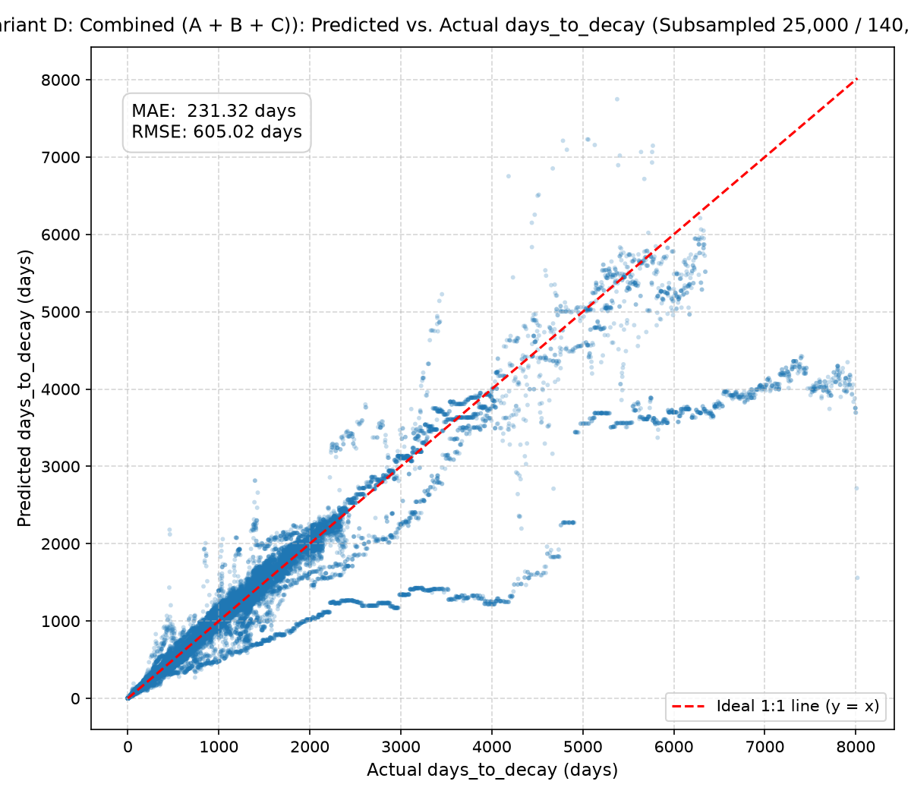](reports/modeling/predicted_vs_actual_variant_d_combined.png) |
| *[View Full Size: Baseline HGB](reports/modeling/predicted_vs_actual_hist_gradient_boosting.png)* | *[View Full Size: Final Model Variant D](reports/modeling/predicted_vs_actual_variant_d_combined.png)* |

| Variant C: Log-Target Transform Alone | Variant A: Physical Days Elapsed Alone |
| :---: | :---: |
| [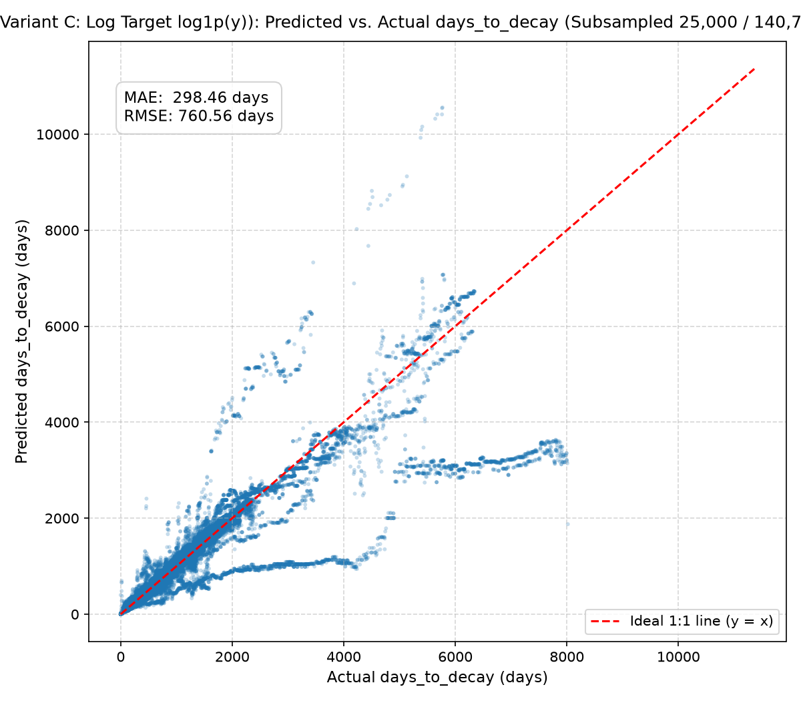](reports/modeling/predicted_vs_actual_variant_c_log.png) | [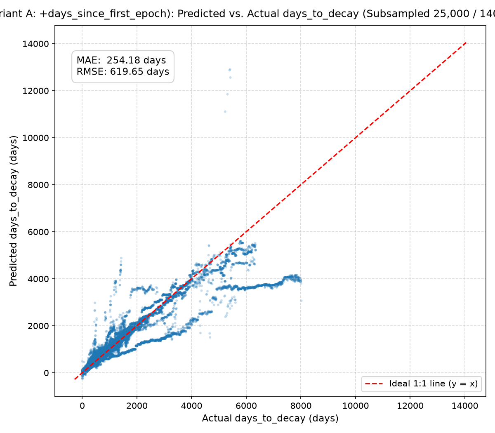](reports/modeling/predicted_vs_actual_variant_a_elapsed.png) |
| *[View Full Size: Variant C](reports/modeling/predicted_vs_actual_variant_c_log.png)* | *[View Full Size: Variant A](reports/modeling/predicted_vs_actual_variant_a_elapsed.png)* |

---

## Final Model Inference & Insights

### 1. What Actually Worked

- **Variant A (`days_since_first_epoch`)** drove the largest reduction in overall variance: overall MAE dropped from **316.89d to 254.18d**, and every decay bucket improved substantially. Adding an explicit physical clock resolved the model's tendency to default to static altitude priors.
- **Variant C (`log1p` Target)** independently resolved the terminal plateau: relative error in the `<30d` bucket dropped from **250.1% to 54.6%** (MAE down to 8.42 days) by removing the loss function's bias toward large-horizon residuals.
- **Variant D (Combined)** delivers compound gains: `<30-day` MAE drops to **2.44 days** (**15.9% relative error**), making short-range re-entry estimates practically useful.

### 2. What Did Not Work (Hypothesis Disproven)

- **Variant B (`short_window_roll3`) was a wash:** It slightly degraded performance across every bucket (overall MAE increased to 319.79d). Rolling window smoothing lag was not the bottleneck; the missing physical clock and target scale mismatch were.

### 3. Transparent Assessment of Long-Horizon Error

Even in the final model, the **`> 365 days` bucket retains an MAE of ~300 days**. This reflects a physical boundary:

- Over multi-year time horizons, 11-year solar cycles, coronal mass ejections, and geomagnetic storm fluctuations introduce atmospheric density uncertainty that cannot be inferred from orbital geometry alone.
- For space debris monitoring and imminent re-entry collision avoidance, the model is strongest where operational warning matters most: **within the final 6 months of decay**.

---

## Pipeline Execution Guide

This project uses [`uv`](https://docs.astral.sh/uv/) for dependency management (Python `>=3.14` required):

```bash
uv sync    # Install dependencies into .venv
```

### Stage 1: Data Ingestion & Preprocessing

```bash
# Ingest raw Space-Track JSONs and attach CelesTrak decay catalog
uv run src/data_processing/01_TLE_json_to_parquet.py

# Validate database completeness and checksums
uv run src/data_processing/02_database_validation.py
```

### Stage 2: Exploratory Data Analysis

```bash
uv run src/data_processing/03_data_profiling.py
uv run src/data_processing/04_temporal_analysis.py
uv run src/data_processing/05_satellite_history_analysis.py
uv run src/data_processing/06_outlier_analysis.py
uv run src/data_processing/07_outlier_investigation.py
uv run src/data_processing/08_duplicate_record_investigation.py
uv run src/data_processing/09_repeated_epoch_analysis.py
```

### Stage 3: Deduplication & Quality Filtering

```bash
# Deduplicate 118,225 redundant duplicate epoch records
uv run src/data_processing/10_apply_deduplication.py

# Filter sub-10-TLE debris fragments (204 -> 195 satellites)
uv run src/data_processing/11_apply_tle_count_filter.py
```

### Stage 4: Feature Extraction & Satellite Partitioning

```bash
# Compute rate features, rolling statistics, and days_to_decay
uv run src/modeling/01_build_features.py

# Validate physical constraints and audit boundary effects
uv run src/modeling/02_feature_validation.py

# Perform strict 80/20 satellite-level entity split
uv run src/modeling/03_train_test_split.py
```

### Stage 5: Baseline Training

```bash
# Train all three baseline architectures (Linear Regression, Random Forest, HistGradientBoosting)
uv run src/training/trainers/train_baseline_models.py
```

### Stage 6: Diagnostics & Improvement Evaluation

```bash
# Step 1: Run bucketed error analysis on baseline models
uv run src/training/evaluation/01_bucketed_error_analysis.py

# Step 2: Audit the 5,000d vs 12,000d outlier cluster (NORAD 37518)
uv run src/training/evaluation/02_outlier_inspection.py

# Steps 3-5: Train and benchmark Variants A, B, C, and Final Model Variant D
uv run src/training/evaluation/03_evaluate_improvements.py
```

---

## Project Status & Roadmap

### Completed Milestones

- [x] Full historical TLE ingestion and CelesTrak decay catalog integration.
- [x] Chronological deduplication rule established with 99.98% agreement proof.
- [x] Debris filtering isolating 195 well-tracked satellites (≥ 15 TLEs each).
- [x] Dynamic feature extraction (altitude loss velocity, drag acceleration, BSTAR volatility).
- [x] Strict zero-leakage satellite-level train/test partitioning (156 train / 39 test).
- [x] Baseline modeling with Linear Regression, Random Forest, and HistGradientBoosting.
- [x] Horizon-specific bucketed error audit discovering the terminal plateau paradox.
- [x] Astrodynamic root-cause diagnosis of NORAD 37518 outlier trajectory.
- [x] Evaluation of temporal progression, short rolling windows, and log scaling.
- [x] Selection and serialization of **Final Model Variant D (2.44d Terminal MAE)**.

### Future Research Directions

- [ ] **Recurrent Sequence Architectures (LSTM / GRU):** Benchmark whether sequence models capturing full historical TLE trajectories improve upon tabular gradient boosted trees.
- [ ] **Solar Flux Integration (F10.7 & Ap Indices):** Ingest historical space weather indices to explicitly model solar cycle atmospheric expansion in the `>365d` regime.
- [ ] **Operational Web Interface:** Deploy an interactive dashboard allowing operators to input current TLE strings and receive real-time decay curves with uncertainty bounds.

---

> [!NOTE]
> **Dataset Availability:** The raw Space-Track TLE archive, intermediate Parquet/CSV datasets, and serialized `.joblib` model files are excluded from this repository (via `.gitignore`) due to their size (~500 MB+ raw/curated datasets; ~3.1 GB total across local data artifacts).

*Verified against `data/modeling/features.parquet` (832,434 rows, 195 satellites, 42 features) and evaluated on 39 held-out test satellites (140,798 rows). Final model weights saved in `models/hgb_variant_d_combined.joblib`.*
