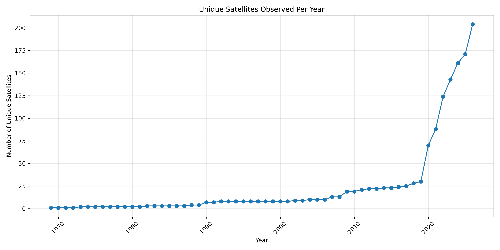
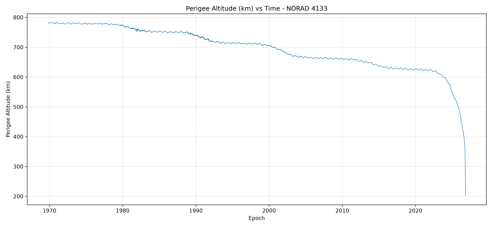
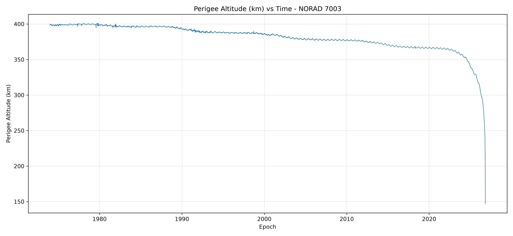
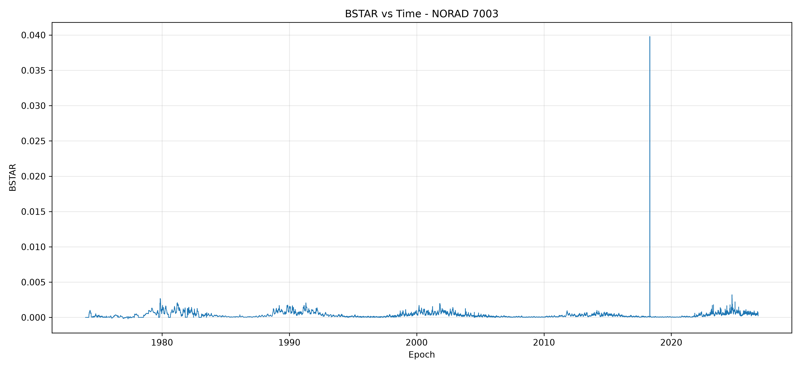
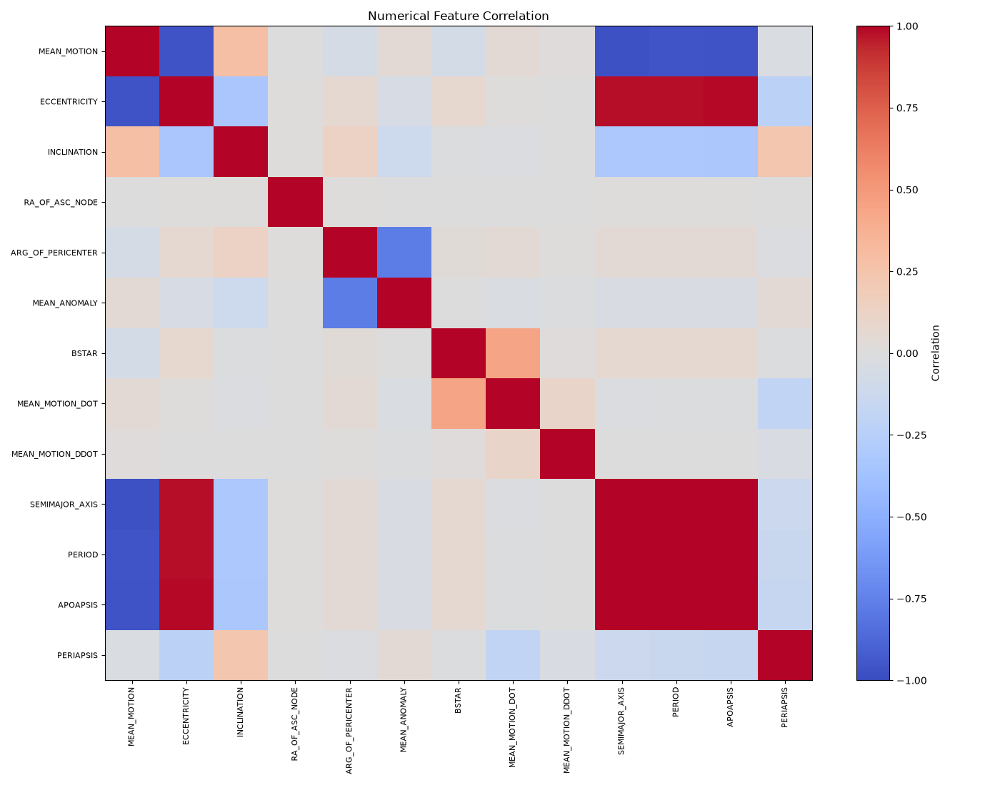
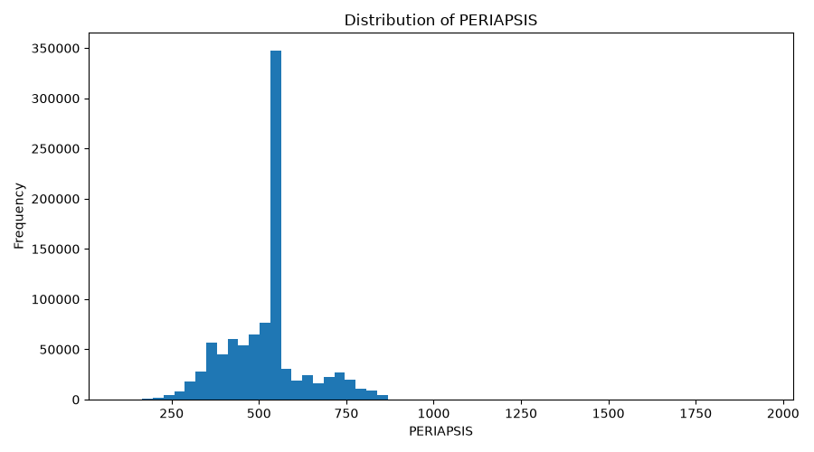
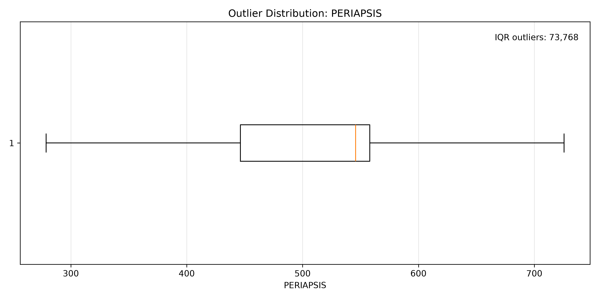

# Satellite Orbital Decay & Atmospheric Re-entry Prediction

An end-to-end data engineering, orbital mechanics profiling, and feature extraction pipeline designed to predict the atmospheric re-entry timelines of Earth-orbiting satellites from historical General Perturbations (GP) Two-Line Element (TLE) observations.

---

## Executive Summary

Orbital decay is driven by non-linear physical interactions between an object's ballistic geometry and upper atmospheric drag. While deterministic numerical propagators (e.g., high-precision numerical orbit propagation models) require continuous atmospheric density forecasting and detailed satellite drag coefficients, empirical and statistical machine learning models offer a data-driven path to estimate remaining on-orbit lifetime directly from historical observation sequences.

This repository implements a production-grade, reproducible data pipeline spanning historical data ingestion, chronological deduplication, physical constraint validation, and dynamic feature extraction across **832,434 curated orbital observations** from **195 decayed LEO satellites** tracked between **1969 and 2026**.

### Dataset & Architecture at a Glance

| Pipeline Stage | Rows | Satellites | Columns | Primary Artifact | Description |
|---|---:|---:|---:|---|---|
| **1. Raw Consolidation** | 950,677 | 204 | 41 | `data/preprocessed/tle_features.parquet` | Lossless ingestion of 204 Space-Track JSON files + CelesTrak decay catalog join |
| **2. Deduplicated Archive** | 832,452 | 204 | 41 | `data/preprocessed/tle_features_modeling.parquet` | Removed 118,225 redundant duplicate epoch records via verified `GP_ID` chronology |
| **3. Filtered Modeling Input** | 832,434 | 195 | 41 | `data/preprocessed/tle_features_modeling.parquet` | Excluded 9 sub-10-record debris fragments unable to support rolling feature computation |
| **4. Feature-Engineered Dataset** | **832,434** | **195** | **42** | `data/modeling/features.parquet` | Dynamic decay rates, multi-span rolling orbital statistics, lifetime index, and target label |

---

## Table of Contents

1. [Data Sources & Ingestion](#data-sources--ingestion)
2. [Repository Structure](#repository-structure)
3. [Core Engineering Decisions & Methodology](#core-engineering-decisions--methodology)
   - [Raw Data Immutability](#1-raw-data-immutability)
   - [Decay Date Provenance Separation](#2-decay-date-provenance-separation)
   - [Chronological Deduplication via GP_ID Agreement](#3-chronological-deduplication-via-gp_id-agreement)
   - [Exclusion of Sparse Debris Fragments](#4-exclusion-of-sparse-debris-fragments)
   - [Adoption of Native Space-Track Geometries](#5-adoption-of-native-space-track-geometries)
   - [Target Formulation & Latency Noise Clipping](#6-target-formulation--latency-noise-clipping)
   - [Dynamic Rates & Rolling Feature Engineering](#7-dynamic-rates--rolling-feature-engineering)
   - [Zero-Leakage Group Validation Requirement](#8-zero-leakage-group-validation-requirement)
4. [Exploratory Data Analysis & Empirical Findings](#exploratory-data-analysis--empirical-findings)
   - [Temporal Distribution & Annual Tracking Density](#temporal-distribution--annual-tracking-density)
   - [Orbital Decay Trajectories (Case Studies)](#orbital-decay-trajectories-case-studies)
   - [Global Parameter Distributions & Correlations](#global-parameter-distributions--correlations)
   - [Outlier Regimes & High-Eccentricity Orbits](#outlier-regimes--high-eccentricity-orbits)
5. [Feature Engineering & Target Correlation Analysis](#feature-engineering--target-correlation-analysis)
   - [Feature Rankings Against Target](#feature-rankings-against-target)
   - [Missing Value Audit & Boundary Effects](#missing-value-audit--boundary-effects)
6. [Pipeline Execution Guide](#pipeline-execution-guide)
7. [Current Project Status & Roadmap](#current-project-status--roadmap)

---

## Data Sources & Ingestion

The pipeline aggregates data across two primary astronomical and space surveillance providers:

### 1. Space-Track.org API (18th Space Defense Squadron)
Historical General Perturbations (GP) orbital element sets provided in OMM (Orbit Mean-Elements Message) JSON format:
- **Identifiers:** `NORAD_CAT_ID`, `OBJECT_ID`, `OBJECT_NAME`
- **Timestamps:** `EPOCH` (observation epoch), `CREATION_DATE` (record generation timestamp)
- **Keplerian Elements:** `MEAN_MOTION` ($n$), `ECCENTRICITY` ($e$), `INCLINATION` ($i$), `RA_OF_ASC_NODE` ($\Omega$), `ARG_OF_PERICENTER` ($\omega$), `MEAN_ANOMALY` ($M$)
- **Perturbations & Native Derived Parameters:** `BSTAR` (drag term $B^*$), `MEAN_MOTION_DOT` ($\dot{n}/2$), `MEAN_MOTION_DDOT` ($\ddot{n}/6$), `SEMIMAJOR_AXIS` ($a$), `PERIOD` ($T$), `APOAPSIS` ($r_a$), `PERIAPSIS` ($r_p$)
- **Catalog Metadata:** `GP_ID`, `FILE`, `TLE_LINE0`, `TLE_LINE1`, `TLE_LINE2`, `OBJECT_TYPE`, `RCS_SIZE`, `COUNTRY_CODE`, `SITE`, `DECAY_DATE`

### 2. CelesTrak Satellite Catalog
Authoritative historical satellite decay registry:
- Joined via `NORAD Catalog Number` $\rightarrow$ `NORAD_CAT_ID`.
- Exports `CATALOG_DECAY_DATE`: 100% complete across all processed satellites.

---

## Repository Structure

```text
satelite/
│
├── data/
│   ├── raw/
│   │   ├── tle_history/                          # 204 raw Space-Track JSON historical files (read-only)
│   │   └── decayed_satellites.csv                # CelesTrak ground-truth decay catalogue (read-only)
│   │
│   ├── preprocessed/
│   │   ├── tle_features.parquet / .csv           # Raw consolidated archive (950,677 rows, 204 sats)
│   │   └── tle_features_modeling.parquet / .csv  # Deduped & filtered dataset (832,434 rows, 195 sats)
│   │
│   └── modeling/
│       ├── features.parquet                      # Final feature-engineered matrix (832,434 rows, 42 cols)
│       └── features.csv                          # Visual inspection CSV
│
├── src/
│   ├── data_collection/
│   │   ├── fetch_spaceTrack.py                   # Automated Space-Track API data collection
│   │   ├── fetch_celesTrack.py                   # CelesTrak decay catalog downloader
│   │   └── verify_tle_jsons.py                   # JSON syntax and schema integrity verifier
│   │
│   ├── data_processing/
│   │   ├── 01_TLE_json_to_parquet.py             # Raw JSON ingestion, string decoding, CelesTrak join
│   │   ├── 02_database_validation.py             # Checksum, range, and completeness validation
│   │   ├── 03_data_profiling.py                  # Statistical profiling and initial distribution plots
│   │   ├── 04_temporal_analysis.py               # Annual observation counts and satellite active spans
│   │   ├── 05_satellite_history_analysis.py      # Individual satellite trajectory case studies
│   │   ├── 06_outlier_analysis.py                # IQR-based outlier flagging across orbital elements
│   │   ├── 07_outlier_investigation.py           # Deep physical dive into extreme orbital regimes
│   │   ├── 08_duplicate_record_investigation.py  # Audit of identical (NORAD, EPOCH) observation pairs
│   │   ├── 09_repeated_epoch_analysis.py         # GP_ID vs CREATION_DATE chronological proof
│   │   ├── 10_apply_deduplication.py             # Production deduplication engine
│   │   └── 11_apply_tle_count_filter.py          # Exclusion of sparse sub-10-TLE debris fragments
│   │
│   ├── modeling/
│   │   ├── 01_build_features.py                  # Label formulation, dynamic rates, and rolling stats
│   │   ├── 02_feature_validation.py              # Physics validation, null audit, target correlations
│   │   └── 03_train_test_split.py                # Satellite-level 80/20 partitioner & skew auditor
│   │
│   └── training/
│       ├── data_loader.py                        # Shared data loader & strict zero-overlap verification
│       ├── trainers/                             # Dedicated model training scripts
│       │   ├── 01_train_linear_regression.py
│       │   ├── 02_train_random_forest.py
│       │   ├── 03_train_hist_gradient_boosting.py
│       │   └── train_baseline_models.py          # Unified runner for all 3 baselines
│       └── evaluation/                           # Dedicated diagnostics & evaluation scripts
│           ├── 01_bucketed_error_analysis.py     # Horizon-specific error breakdown (<30d, 30-180d, etc.)
│           ├── 02_outlier_inspection.py          # Investigation of 5,000d vs 12,000d residual cluster
│           └── 03_evaluate_improvements.py       # Systematic benchmarking of Variants A, B, C, & Combined
│
├── reports/
│   ├── eda/
│   │   ├── column_profile.csv                    # Column completeness, memory footprint, null counts
│   │   ├── numerical_statistics.csv              # Summary moments (mean, median, IQR, percentiles)
│   │   ├── plots/                                # Global orbital distributions and correlation matrices
│   │   ├── temporal/plots/                       # Annual observations and active satellite trends
│   │   ├── satellite_history/                    # Decay trajectories (NORAD 4133, NORAD 7003)
│   │   ├── outliers/plots/                       # Outlier boxplots and scatter distributions
│   │   └── duplicates/                           # Repeated epoch agreement and spread summaries
│   │
│   └── modeling/
│       ├── feature_validation_summary.csv        # Column null audits and infinite checks
│       └── feature_correlations_target.csv       # Pearson and Spearman correlation rankings
│
└── README.md
```

---

## Core Engineering Decisions & Methodology

### 1. Raw Data Immutability
All files in `data/raw/` are treated as immutable storage. Downstream transformations write to separate tiers (`data/preprocessed/` and `data/modeling/`) to guarantee data lineage and repeatability.

### 2. Decay Date Provenance Separation
- **`DECAY_DATE` (Space-Track native):** Populated in only 201 out of 950,677 observations (99.98% missing).
- **`CATALOG_DECAY_DATE` (CelesTrak matched):** Populated across 100% of observations.
- Both fields are preserved independently to prevent silent overwriting of official USSPACECOM records while providing a verified ground truth for modeling.

### 3. Chronological Deduplication via GP_ID Agreement
Exploration in `08_duplicate_record_investigation.py` identified 118,225 records sharing identical `(NORAD_CAT_ID, EPOCH)` keys. Analysis in `09_repeated_epoch_analysis.py` proved:
1. Orbital parameter variations across duplicate records at identical epochs were negligible ($\Delta a < 10^{-4}\text{ km}$).
2. Space-Track internal sequential identifier (`GP_ID`) and publication timestamp (`CREATION_DATE`) agreed on chronological order in **99.98% of comparable record pairs**.
3. **Deduplication Rule:** Within each `(NORAD_CAT_ID, EPOCH)` group, retain the record with the maximum numeric `GP_ID`, breaking ties with the latest `CREATION_DATE`.

```text
Deduplication Outcome:
  Rows before dedup:  950,677
  Rows after dedup:   832,452
  Redundant removed:  118,225 (12.44%)
  Unique epochs lost:       0
```

### 4. Exclusion of Sparse Debris Fragments
In `11_apply_tle_count_filter.py`, satellites with fewer than 10 total historical TLEs were audited. Nine satellites (NORAD IDs: `100822`, `101037`, `101038`, `101040`, `101041`, `101042`, `101047`, `101070`, `101384`) had only 1 to 8 records across their tracking life:
- These sparse fragments cannot support windowed rolling operations or numerical time differencing.
- Removing these 18 observations dropped the satellite count from 204 to **195 well-tracked satellites** (832,434 rows, each with $\ge 15$ TLE observations; median 3,834).

### 5. Adoption of Native Space-Track Geometries
Prior scripts re-calculated semi-major axis, apoapsis, and periapsis using numerical equations:
$$a = \left(\frac{\mu}{n^2}\right)^{1/3}, \quad r_p = a(1-e) - R_E, \quad r_a = a(1+e) - R_E$$
The pipeline now directly consumes Space-Track's native `SEMIMAJOR_AXIS`, `APOAPSIS`, `PERIAPSIS`, and `PERIOD` derived during SGP4 ephemeris generation, eliminating floating-point rounding divergence and standardizing unit definitions.

### 6. Target Formulation & Latency Noise Clipping
The prediction target is remaining orbital lifetime in fractional solar days:
$$\text{days\_to\_decay} = \frac{t_{\text{CATALOG\_DECAY\_DATE}} - t_{\text{EPOCH}}}{86,400\text{ seconds}}$$
Because TLEs are published with operational latency, terminal observations frequently carry epochs recorded within hours after the official catalog decay date, producing small negative values:
- Observations with $\text{days\_to\_decay} \in [-1.0, 0.0)$ are clipped to $0.0$, representing active decay at terminal observation.
- Large negative outliers ($<-1.0\text{ day}$) are isolated and reported for manual audit.

### 7. Dynamic Rates & Rolling Feature Engineering
Orbital decay accelerates exponentially in its terminal phase. In `src/modeling/01_build_features.py`, static orbital parameters are augmented with:
- **Rate-of-Change Metrics:** First numerical time derivatives $\Delta \text{param} / \Delta t$:
  - `periapsis_rate`: Altitude decay velocity in $\text{km/day}$.
  - `mean_motion_rate`: Drag acceleration in $\text{rev/day}^2$.
  - `bstar_rate`: Drag parameter trend.
  - `eccentricity_rate`: Orbit circularization velocity.
- **Rolling Averages:** Multi-span rolling means over 5, 10, and 20 TLE records for `MEAN_MOTION`, `BSTAR`, `ECCENTRICITY`, and `PERIAPSIS`.
- **Drag Volatility:** Multi-span rolling standard deviation of $B^*$ (`bstar_std5`, `bstar_std10`, `bstar_std20`) tracking atmospheric turbulence.
- **Relative Lifetime Index:** Normalized progression along each satellite's observation arc:
  $$\text{lifetime\_fraction} = \frac{\text{Observation Index}}{N_{\text{observations}} - 1} \in [0.0, 1.0]$$

### 8. Zero-Leakage Group Validation Requirement
> [!IMPORTANT]
> Because orbital elements are highly autocorrelated over time, randomly splitting records by row leaks identical satellite states across train and test partitions. All subsequent model evaluation **must use GroupKFold on `NORAD_CAT_ID`**, verifying whether models can predict re-entry for a completely unseen satellite.

---

## Exploratory Data Analysis & Empirical Findings

### Temporal Distribution & Annual Tracking Density

The dataset spans 57 years of spaceflight history (October 1969 to November 2026). While early decades average fewer than 5 active satellites per year, observation frequency increases substantially post-2015 due to high-cadence automated tracking of megaconstellation and smallsat re-entries.

| Annual Observations | Active Satellites per Year |
| :---: | :---: |
|  |  |
| *Observation count evolution across tracking years* | *Unique active decaying satellites tracked per year* |

---

### Orbital Decay Trajectories (Case Studies)

Orbital decay exhibits distinct physical phases: prolonged quasi-linear altitude loss followed by rapid non-linear circularization and terminal plunge.

<details open>
<summary><b>Case Study: NORAD 4133 (Long-Duration High-Cadence Decay)</b></summary>
<br>

| Altitude Collapse (Periapsis vs. Time) | Drag Acceleration (Mean Motion vs. Time) | Ballistic Drag Coefficient ($B^*$ vs. Time) |
| :---: | :---: | :---: |
|  |  |  |
| *Steady altitude dissipation followed by steep terminal plunge* | *Hyperbolic increase in revolutions per day near re-entry* | *Severe drag term volatility under dense atmospheric braking* |

</details>

<details>
<summary><b>Case Study: NORAD 7003</b></summary>
<br>

| Altitude Collapse (Periapsis vs. Time) | Drag Acceleration (Mean Motion vs. Time) | Ballistic Drag Coefficient ($B^*$ vs. Time) |
| :---: | :---: | :---: |
|  |  |  |

</details>

---

### Global Parameter Distributions & Correlations

Orbital elements demonstrate expected astrophysical clustering. Low Earth Orbit satellites exhibit near-circular geometries ($e \approx 0$) with orbital periods concentrated between 88 and 100 minutes.

| Global Linear Correlation Matrix | Observation Epoch Distribution |
| :---: | :---: |
|  |  |
| *Pairwise Pearson correlation across all numerical orbital fields* | *Distribution of observation epochs from 1969 to 2026* |

| Semi-Major Axis ($a$) | Periapsis Altitude ($r_p$) | Ballistic Drag Term ($B^*$) |
| :---: | :---: | :---: |
|  |  |  |

---

### Outlier Regimes & High-Eccentricity Orbits

Statistical outlier analysis (`06_outlier_analysis.py` and `07_outlier_investigation.py`) confirmed that extreme values in the archive reflect genuine astrodynamics rather than data corruption:
- **High-Eccentricity Satellites ($e > 0.5$):** Highly elliptical transfer orbits and Molniya-type orbits with apogees exceeding $30,000\text{ km}$ and periapses deep in LEO.
- **Atmospheric Interface Trajectories:** Observations with perigee altitudes below $130\text{ km}$ correspond to the final orbits immediately preceding destruction.

| Periapsis Outliers | Mean Motion Outliers |
| :---: | :---: |
|  |  |

---

## Feature Engineering & Target Correlation Analysis

The final dataset generated by `src/modeling/01_build_features.py` and validated by `src/modeling/02_feature_validation.py` resides at `data/modeling/features.parquet` (832,434 rows, 42 columns).

### Feature Rankings Against Target

Features ranked by absolute monotonic Spearman correlation ($|r_s|$) with `days_to_decay` from [feature_correlations_target.csv](reports/modeling/feature_correlations_target.csv):

| Feature Name | Spearman ($r_s$) | Pearson ($r$) | Type | Astrodynamic Interpretation |
|---|---:|---:|---|---|
| `mean_motion_roll20` | **-0.7504** | -0.3260 | Derived (Rolling) | Smoothed orbital velocity; strongest decay predictor |
| `mean_motion_roll10` | **-0.7504** | -0.3265 | Derived (Rolling) | Medium-window mean motion |
| `mean_motion_roll5` | **-0.7495** | -0.3268 | Derived (Rolling) | Short-window mean motion |
| `MEAN_MOTION` | **-0.7479** | -0.3270 | Native Element | Instantaneous revolutions per day |
| `SEMIMAJOR_AXIS` | **+0.7479** | +0.2022 | Native Orbital | Orbital energy; higher orbits retain longer lifetimes |
| `PERIOD` | **+0.7478** | +0.1888 | Native Orbital | Orbital period in minutes |
| `APOAPSIS` | **+0.7447** | +0.1851 | Native Orbital | Apogee altitude |
| `lifetime_fraction` | **-0.6943** | -0.4796 | Derived (Progress) | Observation position along satellite's timeline |
| `MEAN_MOTION_DOT` | **-0.5709** | -0.0678 | Native Element | Drag acceleration ($\dot{n}/2$) |
| `PERIAPSIS` | **+0.5025** | +0.3982 | Native Orbital | Perigee altitude |
| `periapsis_roll20` | **+0.4973** | +0.3969 | Derived (Rolling) | Smoothed perigee altitude |
| `mean_motion_rate` | **-0.4919** | -0.0035 | Derived (Rate) | Empirical drag acceleration derivative ($\Delta n / \Delta t$) |
| `periapsis_rate` | **+0.3214** | +0.0051 | Derived (Rate) | Empirical altitude loss velocity ($\Delta r_p / \Delta t$) |
| `bstar_roll20` | **-0.2981** | -0.0384 | Derived (Rolling) | Smoothed ballistic drag coefficient |
| `INCLINATION` | **-0.2741** | -0.1983 | Native Element | Orbital inclination relative to equatorial plane |

### Missing Value Audit & Boundary Effects

Audited in [feature_validation_summary.csv](reports/modeling/feature_validation_summary.csv):
- **Core Orbital Features:** 0 nulls, 0 infinite values across all 832,434 rows.
- **Physical Constraints:** 100% compliant with bound orbital mechanics:
  - $\text{PERIAPSIS} \le \text{APOAPSIS}$ for all rows.
  - $0 \le \text{ECCENTRICITY} < 1$ for all rows.
  - $\text{SEMIMAJOR\_AXIS} > R_{\text{Earth}} \ (6,378.14\text{ km})$ for all rows.
- **Boundary Effect Nulls:** Exactly **195 nulls** ($0.023\%$) appear in `mean_motion_rate`, `periapsis_rate`, `bstar_rate`, `eccentricity_rate`, and `bstar_std5/10/20`.
  - *Mathematical Cause:* Each satellite's initial historical observation has no preceding observation ($t_{-1}$) to evaluate numerical difference ($\Delta t$), naturally producing a single boundary NaN per satellite ($195 \times 1 = 195$).

---

## Pipeline Execution Guide

All execution is managed via the local virtual environment using `uv` or `python`:

### Stage 1: Ingestion & Preprocessing
```bash
# 1. Consolidate raw Space-Track JSONs and attach CelesTrak decay catalog
python src/data_processing/01_TLE_json_to_parquet.py

# 2. Execute database checksum and integrity validation
python src/data_processing/02_database_validation.py
```

### Stage 2: Exploratory Data Analysis
```bash
# 3. Generate summary statistics and global parameter plots
python src/data_processing/03_data_profiling.py

# 4. Perform annual and temporal tracking distribution analysis
python src/data_processing/04_temporal_analysis.py

# 5. Extract individual satellite decay trajectories
python src/data_processing/05_satellite_history_analysis.py

# 6. Flag and investigate orbital element outliers
python src/data_processing/06_outlier_analysis.py
python src/data_processing/07_outlier_investigation.py

# 7. Audit duplicate epochs and confirm chronological GP_ID agreement
python src/data_processing/08_duplicate_record_investigation.py
python src/data_processing/09_repeated_epoch_analysis.py
```

### Stage 3: Deduplication & Filtering
```bash
# 8. Apply chronological deduplication (removes 118,225 redundant rows)
python src/data_processing/10_apply_deduplication.py

# 9. Filter out sparse sub-10-TLE debris fragments (204 -> 195 satellites)
python src/data_processing/11_apply_tle_count_filter.py
```

### Stage 4: Feature Extraction & Validation
```bash
# 10. Extract dynamic rates, rolling features, and compute days_to_decay
python src/modeling/01_build_features.py

# 11. Run full physical sanity checks and correlation validation
python src/modeling/02_feature_validation.py
```

---

## Current Project Status & Roadmap

```text
Pipeline Phase Status:
  [========================================================================] 100% Data Ingestion & Preprocessing
  [========================================================================] 100% Exploratory Data Analysis
  [========================================================================] 100% Chronological Deduplication
  [========================================================================] 100% Debris Filtering & Quality Audit
  [========================================================================] 100% Feature Engineering & Validation
  [>-----------------------------------------------------------------------]   0% Machine Learning Modeling
```

### Completed Work
- [x] Lossless raw data ingestion across 204 Space-Track JSON archives.
- [x] External CelesTrak decay catalog join (100% ground-truth label match).
- [x] TLE checksum verification and data integrity checks.
- [x] Empirical analysis of orbital distributions, tracking density, and temporal coverage.
- [x] Detailed trajectory case studies of terminal satellite plunge (NORAD 4133, NORAD 7003).
- [x] Chronological analysis of 118,225 duplicate epoch pairs proving 99.98% `GP_ID` agreement.
- [x] Production deduplication pipeline preserving unique epochs.
- [x] Debris filtering isolating 195 well-tracked satellites ($\ge 15$ TLEs each).
- [x] Feature engineering pipeline deriving rates of change, rolling stats, and drag volatility.
- [x] Physical orbital constraint validation and target correlation audit.

### Modeling Roadmap (Immediate Next Steps)
- [ ] **Satellite-Grouped Splitting (`03_train_test_split.py`):** Implement `GroupKFold` / `GroupShuffleSplit` on `NORAD_CAT_ID` to strictly enforce zero data leakage across satellites.
- [ ] **Baseline Extrapolation (`04_baseline_models.py`):** Implement a naive linear decay baseline extrapolating current altitude loss velocity ($\Delta r_p / \Delta t$).
- [ ] **Gradient Boosted Decision Trees (`05_train_lgbm.py`):** Train and tune LightGBM, XGBoost, and CatBoost regressors on tabular features.
- [ ] **Horizon-Specific Performance Metrics:** Quantify MAE and RMSE across operational decay horizons:
  - Immediate ($< 7\text{ days}$)
  - Short-term ($7 \text{ to } 30\text{ days}$)
  - Medium-term ($30 \text{ to } 90\text{ days}$)
  - Long-term ($> 90\text{ days}$)
- [ ] **Feature Importance & Ablation:** Compute SHAP (Shapley Additive Explanations) values to determine the relative impact of smoothed mean motion vs. instantaneous drag volatility ($B^*$).

---

*Project status verified against `data/modeling/features.parquet` (832,434 rows, 195 satellites, 42 features). All data processing and feature engineering stages are fully reproducible via the scripts in `src/`.*
